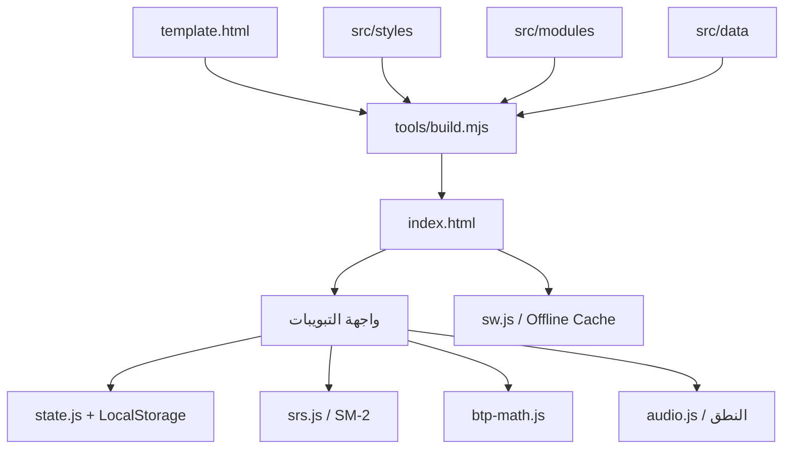

# Français BTP Maroc Pro

تطبيق ويب تقدمي لتعلّم الفرنسية المهنية الخاصة بالبناء والأشغال العمومية في المغرب، مع واجهة عربية/فرنسية واتجاه RTL، ويعمل محلياً دون الاعتماد على خدمات خارجية أثناء التشغيل.

الإصدار الحالي: `4.3.0` · الحد الأدنى لـ Node.js: `20`

## لماذا هذا المشروع؟

يجمع التطبيق بين اللغة التي يحتاجها العامل في الورشة والفرنسية المستعملة في التقارير والمراسلات والصفقات. الهدف هو تحويل المصطلح إلى استعمال عملي، وليس تقديم قاموس منفصل فقط.

## المزايا الرئيسية

| الوحدة | ما توفره |
| --- | --- |
| المفردات | حوالي `1961` مصطلحاً فرنسياً مع الترجمة والنطق والأمثلة والمستويات `A1–B2` |
| الاختبارات | أنماط تدريب سريعة، اختبار مخصص، سجل النتائج، وبنك للأخطاء |
| التكرار المتباعد | مراجعة مبنية على SM-2 وحفظ التقدم محلياً |
| الشيكات والأرقام | محرر شيك تعليمي، تحويل المبلغ إلى كلمات، مكتبة الأرقام، وتدريبات الإملاء |
| القراءة | وثائق وسياقات ميدانية مثل التقارير ومحاضر الورش ودفاتر التحملات |
| الكتابة | نماذج مراسلات وتقارير ورسائل إلكترونية مهنية قابلة للنسخ |
| القواعد | دروس تطبيقية، أفعال الأمر، الأزمنة، التصريف، واختبارات قصيرة |
| الخطة | برنامج تدريبي من `168` يوماً موزعاً على ستة أشهر |
| الحاسبات | الخرسانة، الحديد، الآجور، البلاط، الجبس، الشاحنات والوضعيات المالية |

## التشغيل السريع

### المتطلبات

- Node.js `20` أو أحدث.
- npm.
- متصفح حديث يدعم JavaScript وService Worker.

### تثبيت وتشغيل نسخة التطوير

```powershell
npm install
npm run serve
```

بعدها افتح:

```text
http://localhost:3000
```

للوصول من هاتف على نفس الشبكة، استخدم عنوان IP المحلي للحاسوب بدلاً من `localhost`، مع السماح بالاتصال عبر الشبكة عند الحاجة.

## أوامر المشروع

| الأمر | الاستخدام |
| --- | --- |
| `npm run serve` | تشغيل الخادم المحلي على المنفذ `3000` |
| `npm run build` | تجميع المصدر وإنشاء `index.html` وملفات البيانات التشغيلية |
| `npm run lint` | فحص JavaScript وملفات أدوات البناء بواسطة ESLint |
| `npm run test:unit` | تشغيل اختبارات الوحدات |
| `npm run test:coverage` | قياس تغطية المحركات النقية بواسطة c8 |
| `npm run test:e2e` | تشغيل اختبارات Playwright على الواجهة الحقيقية |
| `npm run validate` | البناء ثم تشغيل الفحوصات البنيوية |
| `npm test` | lint ثم unit ثم build ثم validation |
| `npm run build:netlify` | إنشاء حزمة Netlify |
| `npm run deploy:check` | فحص شامل قبل النشر، بما فيه حزمة Netlify |
| `npm run format` | إعادة تنسيق ملفات JavaScript المحددة |

## نتائج الفحص الحالية

آخر تشغيل محلي ناجح داخل المشروع:

- `29/29` اختبار وحدة ناجح.
- `25/25` فحص تحقق بنيوي ناجح.
- نجاح ESLint والبناء.
- `30/30` اختبار واجهة ناجح على الهاتف واللابتوب.
- فحص حزمة Netlify ناجح (`16` ملفاً، حوالي `1.96 MiB`).
- حجم حزمة `index.html` المجمعة حوالي `558.7KB`.
- فحص الهاتف واللابتوب: لا يوجد تجاوز أفقي.
- قائمة «المزيد» تعمل مع حالة وصول `aria-expanded` وإغلاق بواسطة `Escape`.

اختبار Lighthouse موجود ضمن GitHub Actions ويجب مراجعة نتيجته قبل اعتماد أي إصدار؛ وجود الاختبار لا يعني تلقائياً نجاح آخر تشغيل.

## بنية المشروع

```text
.
├── src/
│   ├── app.js                 # نقطة تشغيل النسخة المعيارية
│   ├── template.html          # قالب HTML المصدر
│   ├── data/                  # مصادر بيانات المفردات والمحتوى
│   ├── modules/               # الحالة، الصوت، SM-2، الحسابات والتبويبات
│   └── styles/                # التصميم، السمة، الحركة والتجاوب
├── data/                      # ملفات بيانات مولدة للتشغيل
├── fonts/                     # Cairo وRoboto Flex محلياً
├── icons/                     # أيقونات PWA
├── tests/unit/                # اختبارات المنطق والمحركات
├── tests/e2e/                 # اختبارات Playwright للهاتف واللابتوب
├── tools/build.mjs            # تجميع المصدر إلى نسخة مستقلة
├── tools/validate-app.mjs     # فحوص HTML والوظائف والبنية
├── tools/server.mjs           # خادم تطوير محلي برؤوس أمان
├── sw.js                      # Service Worker والتخزين المؤقت
├── manifest.json              # تعريف تطبيق PWA
├── index.html                 # نسخة مولدة جاهزة للتشغيل
└── package.json               # الأوامر والاعتماديات التطويرية
```

## طريقة البناء

المصدر الأساسي موجود داخل `src/`. عند تشغيل `npm run build` يقوم `tools/build.mjs` بالخطوات التالية:

1. دمج ملفات CSS بالترتيب الصحيح.
2. تجميع الوحدات البرمجية والبيانات اللازمة للتشغيل المحلي.
3. إنشاء ملفات البيانات الخارجية داخل `data/`.
4. توليد `index.html` المستقل.
5. تصغير الحزمة بشكل محافظ.
6. تحديث هاشات CSP داخل `_headers`.

لذلك يجب تعديل ملفات `src/` و`tools/`، وليس تعديل `index.html` يدوياً؛ لأن التعديل اليدوي سيُستبدل في البناء التالي.

## المعمارية المنطقية



المبدأ الأساسي هو فصل البيانات عن منطق الواجهة قدر الإمكان، مع وجود محركات حساب نقية قابلة للاختبار، وحالة محلية تحفظ تقدم المستخدم.

## تصميم الواجهة والاستجابة

- الاتجاه الافتراضي: `rtl` واللغة الأساسية: العربية.
- الخط العربي: `Cairo`.
- الخط اللاتيني والأرقام: `Roboto Flex`.
- الأرقام المعروضة في الحقول الرقمية تستخدم الاتجاه اللاتيني `1234567890`.
- شريط تنقل سفلي مخصص للهاتف مع قائمة للأقسام الإضافية.
- اختبار Playwright للهاتف مضبوط على ملف OnePlus Nord 5 تقريبي بحجم `424×915`.
- تخطيط اللابتوب يختبر على `1280×720`، مع دعم عروض أكبر.
- دعم `prefers-reduced-motion` و`forced-colors` و`focus-visible`.
- أهداف اللمس الأساسية مصممة لتكون واسعة ومناسبة للاستعمال الميداني.

## العمل دون إنترنت وPWA

يستخدم التطبيق Service Worker لتخزين قشرة التطبيق والبيانات والخطوط محلياً. كما يستخدم Manifest وأيقونات محلية لتثبيته كتطبيق مستقل.

نقاط مهمة:

- لا يعتمد التشغيل الطبيعي على Google Fonts أو CDN خارجي.
- التقدم محفوظ في `localStorage` ويمكن تصديره واستيراده بصيغة JSON.
- البيانات الثابتة تُخزّن مؤقتاً عند توفرها.
- تحديث التطبيق يمر عبر نسخة Service Worker جديدة وبانر تحديث عند الحاجة.
- يجب اختبار التحديث بعد تغيير أسماء الملفات أو إصدار التخزين المؤقت.

## الاختبارات وضمان الجودة

### اختبارات الوحدة

تغطي حالياً:

- تحويل الأرقام إلى الفرنسية.
- تحليل مبالغ الشيكات بصيغ محلية وأوروبية.
- حسابات الخرسانة والحديد والآجور والبلاط والجبس والشاحنات.
- الوضعيات المالية والضرائب والاقتطاعات.
- خوارزمية SM-2.
- تطبيع البحث وثبات معرفات المفردات.
- منطق الاختبارات والخلط.

### اختبارات الواجهة

ملفات `tests/e2e/` تغطي التنقل، RTL، البحث، حفظ التقدم، الاختبارات، الحاسبات، الشيكات، التفاعل باللمس والحالات الخاصة بالحركة.

### CI

ملف `.github/workflows/ci.yml` يشغّل:

- ESLint.
- البناء والتحقق البنيوي.
- اختبارات الوحدة والتغطية.
- Playwright مع Chromium للهاتف واللابتوب.
- Lighthouse للأداء وإمكانية الوصول.

## الأمان

- Content Security Policy مولدة تلقائياً بهاشات للسكربتات المضمّنة.
- لا توجد معالجات `onclick` مضمّنة في القالب؛ التفاعل يمر عبر `data-call` وطبقة تفويض مركزية.
- المخرجات الديناميكية الحساسة تمر عبر `escapeHtml()` حيث يلزم.
- خادم التطوير يتحقق من المسارات ويمنع Path Traversal.
- رؤوس حماية مثل `X-Content-Type-Options` و`X-Frame-Options` و`Referrer-Policy` مفعلة.
- لا يرسل التطبيق تقدم المستخدم إلى خادم خارجي.

## حفظ المشروع على GitHub

ارفع جذر المشروع إلى مستودع GitHub خاص، على فرع `main`. لا تضف ملفات بداية من واجهة GitHub (README أو ترخيص أو `.gitignore`) لأن هذه الملفات موجودة محلياً. بعد ربط المستودع، تعمل فحوص GitHub Actions تلقائياً عند كل رفع أو Pull Request.

الملف `data/lifeos_pwa_data.json` تصدير شخصي محلي، وهو مستثنى من Git. مجلدات البناء والاختبارات والتغطية وملفات `.env` مستثناة كذلك. راجع `git status` و`git diff --cached --name-only` قبل أي رفع للتأكد من عدم إضافة بيانات خاصة.

## النشر على Netlify

### الفحص قبل النشر

```powershell
npm run deploy:check
```

ينشئ الأمر حزمة نظيفة داخل `dist/` ويفحص ملفات Netlify وService Worker وCSP والرؤوس الأمنية والكاش. لا تنشر مجلد المشروع كاملاً بدلاً من `dist/`.

### النشر من Git

ملف `netlify.toml` يضبط الإعدادات تلقائياً:

- Build command: `npm run build:netlify`
- Publish directory: `dist`
- Node.js: `20`
- Netlify post-processing: معطّل لحماية CSP hashes المولّدة أثناء البناء

اربط المستودع بـNetlify واترك Base directory فارغاً ما دام `package.json` موجوداً في جذر المشروع.

### النشر اليدوي

بعد نجاح `npm run deploy:check` اسحب مجلد `dist/` فقط إلى Netlify Drop. بعد اكتمال النشر افتح الموقع في نافذة خاصة للتأكد من تحميل Service Worker والإصدار الجديد بدون Cache قديم.

## إضافة أو تعديل المحتوى

1. عدّل المصدر المناسب داخل `src/data/`.
2. حافظ على الحقول المطلوبة في السجلات الحالية.
3. استخدم `escapeHtml()` عند عرض أي قيمة ديناميكية داخل HTML.
4. شغّل `npm test`.
5. شغّل `npm run test:e2e` عند تعديل تفاعل أو تخطيط.
6. راجع الهاتف واللابتوب بصرياً قبل اعتماد التغيير.

عند تعديل محتوى قانوني أو مالي أو حسابات ميدانية، يجب تسجيل المصدر وتاريخ المراجعة ومطابقة المعلومات مع مختص مؤهل.

## إخلاء المسؤولية

الحاسبات والنماذج والمعلومات القانونية الموجودة في التطبيق تعليمية وتقديرية. لا تستبدل التصميم الإنشائي المعتمد، أو مراجعة المهندس المسؤول، أو الاستشارة القانونية، أو شروط الصفقة الخاصة. يجب التحقق من القوانين والضرائب والمواصفات المغربية السارية قبل استعمال النتائج في وثيقة رسمية أو قرار مهني.

## حدود الإصدار الحالي

- التقدم محفوظ محلياً ولا توجد مزامنة سحابية بين الأجهزة.
- بعض الصفحات تحتوي كمية كبيرة من المعلومات وتحتاج إلى تقسيم إضافي في الإصدارات القادمة.
- ملفات CSS وبعض وحدات JavaScript كبيرة وتحتاج إلى إعادة تنظيم تدريجية.
- مراجعة المحتوى بواسطة خبراء المجال خطوة ضرورية قبل الاعتماد الرسمي أو التجاري.

## مسار التحسين المقترح

1. تقسيم ملفات CSS والوحدات الكبيرة إلى مكونات أصغر.
2. رفع تغطية اختبارات الوصول وإضافة فحص axe آلي.
3. إضافة اختبارات Lighthouse مرئية وحدود حجم للحزمة.
4. تحسين جلسة التعلم اليومية ومراجعة الأخطاء.
5. توفير نسخ احتياطي ومزامنة اختيارية مع احترام الخصوصية.
6. توثيق مصادر المحتوى وإصداراته ومواعيد مراجعته.

© 2026 Français BTP Maroc Pro — المغرب 🇲🇦
