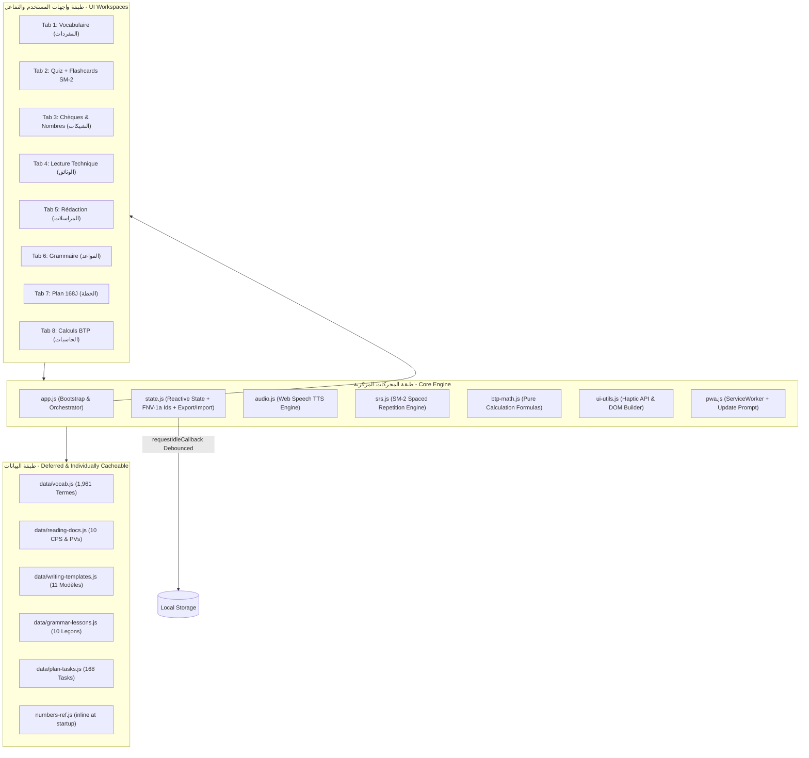
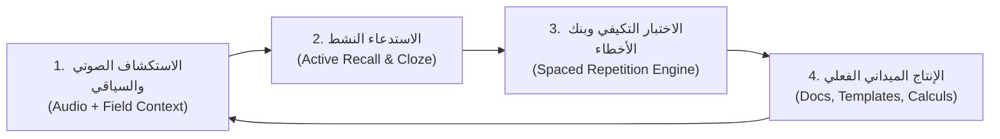

# 🏗️ Français BTP Maroc Pro v3.1.1 (2026 Edition)
### المرجع التقني واللغوي الشامل لمهندسي وأطر البناء والأشغال العمومية بالمغرب

> **تطبيق ويب تقدمي (Progressive Web App) فائق الأداء والسرعة (120 FPS / GPU Accelerated)، مصمم خصيصاً للمهندسين المدنيين، مسيري وموصلّي الأشغال (*Conducteurs de Travaux*)، رؤساء الأوراش (*Chefs de Chantier*)، والمترورين (*Métreurs*) في المغرب، لتمكينهم من تملك المصطلحات الهندسية، صياغة المراسلات الرسمية، تفكيك دفاتر التحملات (CPS)، حساب الكميات (Métré)، وتحرير الشيكات والوضعيات المالية وفق معايير دفتر الشروط الإدارية العامة (CCAG-T) والمواصفات القياسية المغربية (NM).**

---

<p align="center">
  
  
  
  
  
  
  
  
  
</p>

---

## 📑 فهرس المحتويات الشامل (Table des Matières)

1. [🌟 فلسفة المشروع والقيمة المضافة لسوق البناء المغربي](#-فلسفة-المشروع-والقيمة-المضافة-لسوق-البناء-المغربي)
2. [⚙️ المعمارية البرمجية وخريطة النظام (System Architecture)](#️-المعمارية-البرمجية-وخريطة-النظام-system-architecture)
3. [🧠 المنهج العلمي للاكتساب النشط للمفردات (Pedagogical Protocol)](#-المنهج-العلمي-للاكتساب-النشط-للمفردات-pedagogical-protocol)
4. [📦 التحليل الهندسي والوظيفي للأقسام الثمانية (The 8 Workspaces)](#-التحليل-الهندسي-والوظيفي-للأقسام-الثمانية-the-8-workspaces)
   - [القسم 1: 📚 المفردات الميدانية (1,961 مصطلحاً هندسياً)](#القسم-1--المفردات-الميدانية-1961-مصطلحا-هندسيا)
   - [القسم 2: 🎯 محرك الاختبارات وبنك الأخطاء الذكي](#القسم-2--محرك-الاختبارات-وبنك-الأخطاء-الذكي)
   - [القسم 3: 🏦 محاكي الشيكات والأرقام والمبالغ المرجعية](#القسم-3--محاكي-الشيكات-والأرقام-والمبالغ-المرجعية)
   - [القسم 4: 📑 قراءة وتحليل وثائق الورش المغربية (10 وثائق حقيقية)](#القسم-4--قراءة-وتحليل-وثائق-الورش-المغربية-10-وثائق-حقيقية)
   - [القسم 5: ✍️ صياغة المراسلات والتقارير ومساعد الإيميلات (11 قالباً)](#القسم-5--صياغة-المراسلات-والتقارير-ومساعد-الإيميلات-11-قالبا)
   - [القسم 6: 📐 قواعد لغة الورشة وتصريف الأفعال الهندسية](#القسم-6--قواعد-لغة-الورشة-وتصريف-الأفعال-الهندسية)
   - [القسم 7: 📅 خطة التكوين الميداني (168 يوماً / 6 أشهر)](#القسم-7--خطة-التكوين-الميداني-168-يوما--6-أشهر)
   - [القسم 8: 🧮 حاسبات الورش، المتراج والوضعيات المالية (7 حاسبات)](#القسم-8--حاسبات-الورش-المتراج-والوضعيات-المالية-7-حاسبات)
5. [🎨 نظام الحركات والتفاعل اللمسي (120Hz Motion & Haptics)](#-نظام-الحركات-والتفاعل-اللمسي-120hz-motion--haptics)
6. [📱 التوافق الميداني مع الهواتف الذكية (OnePlus Nord 5 Profile)](#-التوافق-الميداني-مع-الهواتف-الذكية-oneplus-nord-5-profile)
7. [♿ معايير إمكانية الوصول والتنقل (Accessibility & WCAG 2.1 AA)](#-معايير-إمكانية-الوصول-والتنقل-accessibility--wcag-21-aa)
8. [📶 العمل أوفلاين والويب التقدمي (Service Worker & Cache Storage)](#-العمل-أوفلاين-والويب-التقدمي-service-worker--cache-storage)
9. [🧪 منظومة الاختبارات وضمان الجودة (Full Test Pyramid)](#-منظومة-الاختبارات-وضمان-الجودة-full-test-pyramid)
10. [📊 شبكة المعرفة البرمجية (Graphify Knowledge Graph)](#-شبكة-المعرفة-البرمجية-graphify-knowledge-graph)
11. [🔗 الارتباط بنظام الحياة والإنتاجية (HMZ Life OS Integration)](#-الارتباط-بنظام-الحياة-والإنتاجية-hmz-life-os-integration)
12. [🚀 أوامر التشغيل والبناء والنشر (Deployment Guide)](#-أوامر-التشغيل-والبناء-والنشر-deployment-guide)
13. [⚖️ إخلاء المسؤولية الهندسية والقانونية](#️-إخلاء-المسؤولية-الهندسية-والقانونية)

---

## 🌟 فلسفة المشروع والقيمة المضافة لسوق البناء المغربي

تتميز بيئة الأوراش والبناء في المغرب بازدواجية لغوية معقدة:
* **لغة الميدان الشفهية:** الدارجة المغربية والمصطلحات التقنية المعربة بين العمال والمعلمين.
* **لغة الإدارة والصفقات:** الفرنسية التقنية والقانونية الصارمة المطلوبة في دفاتر التحملات (**CPS**)، محاضر الاجتماعات (**PV de Chantier**)، استلامات مكاتب المراقبة (**Bureaux de Contrôle**)، وتقارير المختبرات الجيوتقنية (**Laboratoires LPEE/CTC**).

يهدف تطبيق **Français BTP Maroc Pro** إلى سد هذه الفجوة جذرياً عبر تقديم منظومة تفاعلية محمولة وخفيفة تعمل في جيب المهندس الميداني دون الحاجة لشبكة الإنترنت، لتمكينه من التعبير بدقة وثقة أمام المهندس المعماري (*Architecte*)، مكتب الدراسات (*BET*)، وصاحب المشروع (*Maître d'Ouvrage*).

```text
┌─────────────────────────────────────────────────────────────────────────────┐
│                    Français BTP Maroc Pro — Core Strengths                  │
├─────────────────────────────────────────────────────────────────────────────┤
│ ⚡ أداء لحظي فائق: إقلاع سريع وتمرير سلس عند 120 FPS عبر تسريع GPU عتادي    │
│ 📴 أوفلاين بنسبة 100%: خطوط وبيانات مستضافة محلياً + Service Worker شامل    │
│ 🧠 مراجعة علمية: بطاقات تكرار متباعد SM-2 لبناء ذاكرة طويلة المدى           │
│ 🏗️ مرجعية مغربية دقيقة: موافقة لـ CCAG-T Maroc، ونسب الخرسانة، واقتطاع 10% │
│ 🔐 أمان مُختبَر: CSP بلا أطراف خارجية، تنقية HTML، حماية من Path Traversal │
│ 🧪 هرم اختبارات كامل: 29 Unit + 10 E2E + 24 فحصاً بنيوياً على GitHub Actions│
│ 📤 نقل التقدم: تصدير/استيراد نسخة JSON بين الأجهزة بلا أي خادم             │
└─────────────────────────────────────────────────────────────────────────────┘
```

---

## ⚙️ المعمارية البرمجية وخريطة النظام (System Architecture)

يعتمد التطبيق على معمارية معيارية حديثة **Vanilla ES6 Modules** تفصل البيانات عن المتحكمات وعن شجرة الـ DOM، مما يلغي الاعتماد على أي مكتبات ثقيلة ويضمن أقصى درجات الأمان والسرعة:



> **ملاحظة معمارية (2026):** قواعد البيانات الأربعة الكبرى (`reading-docs`, `writing-templates`, `grammar-lessons`, `plan-tasks`) تُحمَّل عبر `<script defer>` كملفات خارجية مستقلة — لا تعطل أول رسم للصفحة، ويُخزَّن كل منها في Service Worker وشبكة CDN بمدة `immutable` منفصلة. أما `numbers-ref.js` فيبقى مضمّناً لأن محرك الشيكات يعتمد عليه عند الإقلاع.

### هيكل المستودع المنظم (Repository File Tree):

```text
.
├── src/                          # كود المصدر المعياري النقي
│   ├── styles/                   # طبقات CSS المعيارية المنفصلة
│   │   ├── fonts.css             # @font-face للخطوط المتغيرة المستضافة محلياً
│   │   ├── tokens.css            # متغيرات التصميم والمسافات (Design Tokens)
│   │   ├── base.css              # التصفير، الخطوط، وتجاوب إمكانية الوصول
│   │   ├── components.css        # أنماط المكونات، البطاقات، والتبويبات
│   │   ├── md3-theme.css         # سمة الدار البيضاء Casablanca Dusk و Material You
│   │   ├── motion.css            # محرك الرسوم وتسريع GPU بمعدل 120Hz
│   │   └── mobile-nord5.css      # ملف التجاوب المخصص لشاشات هواتف أندرويد
│   ├── data/                     # مجموعات البيانات (المصدر الكنسي)
│   │   ├── reading-docs.js       # وثائق الورش العشر
│   │   ├── writing-templates.js  # نماذج المراسلات الـ 11
│   │   ├── grammar-lessons.js    # دروس القواعد العشر وجداول الأفعال
│   │   ├── plan-tasks.js         # مهام الخطة الـ 168 يوماً
│   │   └── numbers-ref.js        # مراجع الأرقام + رموز النطق العربي
│   ├── modules/                  # المنطق البرمجي والمتحكمات
│   │   ├── state.js              # الحالة، البصمات الثابتة، تصدير/استيراد التقدم
│   │   ├── btp-math.js           # دوال الحساب النقية القابلة للاختبار
│   │   ├── srs.js                # محرك التكرار المتباعد SM-2
│   │   ├── audio.js              # محرك النطق الصوتي TTS والتسخين المسبق
│   │   ├── ui-utils.js           # دوال DOM، التوست، والتفاعل اللمسي Haptic
│   │   ├── pwa.js                # التثبيت + Service Worker + بانر التحديث
│   │   └── tabs/                 # متحكمات التبويبات الثمانية المستقلة
│   │       ├── vocab-tab.js ... calc-tab.js
│   ├── app.js                    # نقطة الانطلاق الرئيسية (Entry Bootstrap)
│   └── template.html             # هيكل الواجهة الدلالي HTML5
├── data/                         # ملفات البيانات المولّدة للتشغيل (window globals)
├── fonts/                        # Cairo + Roboto Flex متغيرة (woff2 — مستضافة محلياً)
├── tests/
│   ├── unit/                     # 29 اختبار وحدة (node:test) — أرقام، رياضيات BTP، SM-2، حالة
│   ├── e2e/                      # 10 سيناريوهات Playwright على متصفح Chromium حقيقي
│   └── helpers/                  # محمّل موديولات VM لبيئة المتصفح المحاكاة
├── .github/workflows/ci.yml      # خط CI: lint → build → validate → unit → e2e
├── dist/                         # حزمة الإنتاج الجاهزة للنشر على Netlify
├── graphify-out/                 # شبكة المعرفة البرمجية (375 عقدة و 739 رابطاً)
├── icons/                        # أيقونات الـ PWA المعيارية
├── tools/                        # أدوات البناء والفحص بدون أي حزم تشغيلية
│   ├── build.mjs                 # مجمّع البناء: يولّد index.html + data/*.js
│   ├── validate-app.mjs          # 24 فحصاً بنيوياً صارماً
│   ├── build-netlify.mjs         # مُنشئ حزمة التوزيع الخاصة بـ Netlify
│   └── server.mjs                # خادم تطوير آمن: CSP + حماية Path Traversal
├── eslint.config.js              # قواعد ESLint 9 (flat config)
├── playwright.config.js          # إعدادات E2E مع خادم تلقائي
├── sw.js                         # الـ Service Worker — تخزين شامل للأصول والخطوط
├── manifest.json                 # ملف تعريف تطبيق الويب PWA
├── index.html                    # الملف المترجم المستقل الجاهز للتشغيل
└── package.json                  # type: module — أوامر test/lint/format/e2e
```

---

## 🧠 المنهج العلمي للاكتساب النشط للمفردات (Pedagogical Protocol)

يعتمد التطبيق على خوارزمية **الاكتساب النشط والتكرار المتباعد الميداني (Active Spaced Acquisition)** المستندة إلى علم النفس الإدراكي:



1. **الاستكشاف الصوتي والسياقي (Auditory & Contextual Anchoring):** كل مصطلح هندسي مقترن بنطق صوتي فرنسي طبيعي وجملة تطبيقية مقتبسة من الواقع العملي (مثل أعمال الصب، التسليح، وفحوصات الهبوط *Slump Test*).
2. **الاستدعاء النشط (Active Recall):** تمارين إكمال الجمل الميدانية (**Cloze Tests**) حيث يختفي المصطلح في فراغ `_______` ليجبر العقل على إنتاج الكلمة وتثبيتها.
3. **التكرار المتباعد وبنك الأخطاء (Wrong Answer Bank):** حفظ تلقائي لأي إجابة خاطئة في التخزين المحلي، وتخصيص وضع تدريب مكثف لإعادة مراجعتها حتى الإتقان الكامل.
4. **الإنتاج الميداني الفعلي (Active Production):** ربط المصطلحات فورياً بكتابة الشيكات البنكية، قراءة دفاتر التحملات (CPS)، وتوليد مراسلات ورش حقيقية.

---

## 📦 التحليل الهندسي والوظيفي للأقسام الثمانية (The 8 Workspaces)

```text
┌───┬──────────────────────────────────┬───────────────────────────────────────┐
│ # │ القسم والوحدة الوظيفية           │ المحتوى والوظيفة الحقيقية             │
├───┼──────────────────────────────────┼───────────────────────────────────────┤
│ 1 │ 📚 المفردات (Vocabulaire)        │ 1,961 مصطلحاً مع الصوت والأمثلة       │
│ 2 │ 🎯 محرك الاختبارات (Quiz Engine) │ 4 أنماط اختبار + بنك الأخطاء + Streaks│
│ 3 │ 🏦 الشيكات والأرقام (Chèques)    │ محاكي شيكات مغربية بالدرهم + ختم معتمد│
│ 4 │ 📑 القراءة الفنية (Lecture)      │ 10 وثائق حقيقية (CPS, PV, Rapports)   │
│ 5 │ ✍️ المراسلات (Rédaction)         │ 11 قالباً رسمياً + مساعد إيميلات      │
│ 6 │ 📐 قواعد الورشة (Grammaire)      │ 10 دروس تطبيقية + تصريف أفعال الهندسة │
│ 7 │ 📅 خطة 6 أشهر (Plan 168 Jours)   │ مسار يومي مركز مع متتبع إنجاز         │
│ 8 │ 🧮 حاسبات الورش (Calculs BTP)    │ 7 حاسبات للخرسانة، الحديد، والمالية  │
└───┴──────────────────────────────────┴───────────────────────────────────────┘
```

---

### القسم 1: 📚 المفردات الميدانية (1,961 مصطلحاً هندسياً)
* **قاعدة بيانات هندسية عملاقة:** 1,961 مصطلحاً تخصصياً تغطي المراحل الإنشائية الست:
  1. *الأساسات والحفر (Terrassement & Fondations)*
  2. *الهيكل والخرسانة المسلحة (Gros Œuvre & Structure)*
  3. *الكتامة والنجارة والسطح (Étanchéité & Menuiserie)*
  4. *الأشغال الثانوية (Second Œuvre: Plomberie, Électricité)*
  5. *التشطيبات والديكور (Finitions & Revêtements)*
  6. *التسيير والسلامة والأدوات (Gestion, Sécurité & Matériel)*
* **محرك بحث فائق السرعة (< 0.8ms):** بحث فوري يتجاهل علامات التشكيل وحروف المد بفضل الفهرسة المسبقة في الذاكرة `getVocabSearchIndex()`.
* **فلاتر المستويات الأوروبية (A1, A2, B1, B2):** للارتقاء التدريجي في التعلم.
* **التمرير اللانهائي الذكي (Infinite Scroll):** تحميل دفعات الكلمات بسلاسة عبر `IntersectionObserver`.

---

### القسم 2: 🎯 محرك الاختبارات وبنك الأخطاء الذكي
* **4 أنماط تدريبية متقدمة:**
  1. *فرنسية ⬅️ عربية* (اختيار من متعدد).
  2. *عربية ⬅️ فرنسية*.
  3. *التعرف الصوتي (Écoute & Identification)*.
  4. *إكمال الجمل الميدانية (Cloze Context Test)*.
* **أوضاع التدريب السريع:**
  - **تحدي الـ 10 السريعة:** جلسة سريعة لتثبيت المعلومات.
  - **سباق الـ 60 ثانية (Speed Drill):** اختبار السرعة تحت الضغط مع مؤقت تنازلي حي.
  - **معالجة أخطائي السابقة:** جلسة تدريبية مخصصة للكلمات المسجلة في بنك الأخطاء.
* **🃏 بطاقات التكرار المتباعد SM-2 (جديد 2026):**
  - محرك مراجعة علمي كامل (`src/modules/srs.js`) بمعادلات SM-2 المعتمدة: عامل السهولة EF (بحد أدنى 1.3)، سلالم الفواصل (1 يوم ← 6 أيام ← مضاعفة حسب الإتقان).
  - أربعة أزرار تقييم بعد كشف الإجابة: 😵 نسيت · 😅 صعب · 👍 جيد · ⚡ سهل — وكل تقييم يعيد جدولة البطاقة تلقائياً.
  - عداد «المستحق اليوم» وجلسات بحد 20 بطاقة مرتبة بحسب أقرب موعد استحقاق.
  - اختصارات لوحة مفاتيح كاملة: `Enter` لكشف الإجابة، `1–4` للتقييم.
* **نظام المتتالية الحماسية (🔥 Streak):** عداد بصري يحفز الاستمرارية مع اهتزازات لمسية تصاعدية.
* **دعم اختصارات الكيبورد:** الأزرار `1-4` للإجابة، `Enter` للتالي، `A` للاستماع، و `H` للتلميح.

### 📤 نقل التقدم بين الأجهزة (Progress Portability)
* **تصدير بنقرة واحدة:** زر `📤 تصدير` في رأس تبويب المفردات يُنزّل ملف `btp-maroc-progress-YYYY-MM-DD.json` يضم: الكلمات المتقنة، أيام الخطة، أفضل نتيجة، بنك الأخطاء، جدول SM-2، وتقدم القراءة.
* **استيراد مُتحقق منه:** زر `📥 استيراد` يقرأ الملف ويصادق على مخطط البيانات (`app: francais-btp-maroc`) قبل الدمج، مع هجرة المفاتيح القديمة تلقائياً ورفض الملفات الغريبة برسالة واضحة.
* **بدون أي خادم:** النسخ الاحتياطي يتم عبر ملف محلي تحفظه أنت — خصوصية كاملة وسيادة تامة على بياناتك.

---

### القسم 3: 🏦 محاكي الشيكات والأرقام والمبالغ المرجعية
* **محول الأرقام إلى حروف فرنسية معتمد قانونياً:**
  - معالجة دقيقة لجميع الحالات الخاصة في قواعد الأكاديمية الفرنسية:
    $$\text{71} \rightarrow \text{soixante-et-onze} \quad | \quad \text{80} \rightarrow \text{quatre-vingts} \quad | \quad \text{81} \rightarrow \text{quatre-vingt-un}$$
    $$\text{200} \rightarrow \text{deux cents} \quad | \quad \text{201} \rightarrow \text{deux cent un} \quad | \quad \text{1000} \rightarrow \text{mille (invariable)}$$
* **محاكاة الشيك البنكي المغربي:**
  - تصميم رسمي مائي (*Guilloche Security Pattern*)، إطار مذهب ثلاثي الأبعاد للمبلغ، وإمكانية اختيار البنوك المغربية الرئيسية (Attijariwafa, Banque Populaire, BMCE, CIH, Crédit Agricole, SGMB).
* **خاتم الشيك المصدق (Chèque Certifié):**
  - ختم أحمر تفاعلي يرتطم بالشيك بفيزياء ارتداد حقيقية مع اهتزاز لمسي عميق.
* **مفكك الأرقام الصرفي (Number Decomposer):**
  - شرح القواعد اللغوية لأي رقم مدخل فورياً، مع 64 بطاقة للأعداد وجدول لـ 24 فاتورة مرجعية شائعة في الصفقات.

---

### القسم 4: 📑 قراءة وتحليل وثائق الورش المغربية (10 وثائق حقيقية)
* **10 وثائق هندسية واقعية كاملة وفق معايير المغرب:**
  1. *دفتر التحملات للخرسانة المسلحة (CPS Gros Œuvre & Béton Armé)*
  2. *محضر الاستلام المؤقت للأشغال (PV de Réception Provisoire)*
  3. *وصل طلب وتسليم الخرسانة B25 (Bon de Commande & Livraison)*
  4. *تقرير التجارب الجيوتقنية والخرسانة (Rapport Géotechnique)*
  5. *أمر بداية الأشغال الرسمي (Ordre de Service de Démarrage - OS)*
  6. *بطاقة عدم المطابقة الميدانية (Fiche de Non-Conformité - FNC)*
  7. *عقد مقاولة فرعية لأشغال البناء (Contrat de Sous-Traitance)*
  8. *فاتورة كراء عتاد ورافعات (Facture de Matériel)*
  9. *البطاقة التقنية لإسمنت البناء CPJ 45 (Fiche Technique)*
  10. *تعليمات السلامة والصحة المهنية (Consignes de Sécurité HSE)*
* **شريط التنقل الداخلي الرباعي:**
  - `📄 نص الوثيقة` · `💡 المفردات المساعدة` · `❓ أسئلة الفهم الذاتي` · `📐 دليل التحليل الهندسي والتنظيمي`.

---

### القسم 5: ✍️ صياغة المراسلات والتقارير ومساعد الإيميلات (11 قالباً)
* **11 قالباً رسمياً جاهزاً للتوليد الفوري:**
  - *وصل الطلب (Bon de Commande)*
  - *تقرير تقدم الأشغال الدوري (Rapport d'Avancement)*
  - *محضر اجتماع الورشة (PV de Réunion)*
  - *الفاتورة الأولية (Facture Proforma)*
  - *تقرير عدم المطابقة (FNC)*
  - *طلب رخصة صب الخرسانة (Autorisation de Coulage)*
  - *طلب الاستلام المؤقت (Demande de Réception)*
  - *شهادة العمل الميدانية (Attestation de Travail)*
  - *طلب اعتماد المواد (Demande d'Agrément des Matériaux)*
  - *رسالة توجيه إعذار لمقاول فرعي (Mise en Demeure)*
  - *تقرير حادث ورشة (Rapport d'Accident)*
* **مساعد صياغة الرسائل الإلكترونية (Email Assistant):** توليد مراسلات فورية لـ 4 سيناريوهات مغربية واقعية مع زر نسخ فوري مضيء (📋).
* **بنك العبارات الميدانية (40+ صيغة جاهزة):** مصنفة ومزودة ببحث لحظي.

---

### القسم 6: 📐 قواعد لغة الورشة وتصريف الأفعال الهندسية
* **10 دروس قواعد تطبيقية ميدانية:**
  - صيغة الأمر لإعطاء التعليمات للعمال (*L'Impératif*).
  - صيغة المبني للمجهول لكتابة التقارير الرسمية (*Le Passif*).
  - التعبير عن المقاسات والأبعاد والكميات.
  - صيغة الشرط والاحترام في المراسلات (*Le Conditionnel de Politesse*).
* **قوائم قابلة للطي بانسيابية:** تعتمد على حساب الارتفاع الحقيقي `scrollHeight` لحركة فتح سينمائية.
* **كويز القواعد التفاعلي:** 8 أسئلة تصحح ذاتياً مع تفسير لغوي لكل إجابة.
* **جدول تصريف الأفعال الهندسية:** تصريف شامل لـ 6 أفعال رئيسية (*Couler, Coffrer, Ferrailler, Réceptionner, Vérifier, Commander*) عبر 5 أزمنة.

---

### القسم 7: 📅 خطة التكوين الميداني (168 يوماً / 6 أشهر)
* **مسار تدريبي منظم على 24 أسبوعاً:** بمعدل 15–20 دقيقة يومياً.
* **ربط مباشر بالأنشطة:** كل يوم يوجهك مباشرة للتبويب المناسب بنقرة زر (`ابدأ النشاط ↗`).
* **تأثير احتفال زنبركي (`.checkboxCheckPop`):** حركة ارتداد عند تحديد المهمة مع حفظ دائم في الذاكرة المحلية `localStorage`.
* **أشرطة تقدم تفاعلية:** حساب نسبة الإنجاز الإجمالية والشهرية وتحديد الأيام المتبقية.

---

### القسم 8: 🧮 حاسبات الورش، المتراج والوضعيات المالية (7 حاسبات)
* **1. حاسبة الخرسانة (Béton B25 Dosage 350kg):**
  - حساب الحجم المكعب مع 3% نسبة ضياع، أكياس الإسمنت CPJ 45، الرمل، الحصى، والماء مع **شريط بياني ملون متناسب** يوضح نسب الخلطة فورياً:
    $$\text{Ciment (25\%)} \quad | \quad \text{Sable (25\%)} \quad | \quad \text{Gravette (38\%)} \quad | \quad \text{Eau (12\%) }$$
* **2. حاسبة حديد التسليح (Acier Haute Adhérence FeE500):**
  - تحويل أقطار الحديد من T6 إلى T25 إلى الوزن بالكيلوغرام والطن وعدد القضبان التجارية بطول 12 متراً وفق المواصفة المغربية `NM 01.4.096`:
    $$\text{Poids Métrique } (\text{kg/m}) = \frac{D^2}{162}$$
* **3. حاسبة الياجور والملاط (Briques & Mortier):** حساب المساحة، عدد الوحدات، وأكياس ملاط البناء مع نسبة هالك 5%.
* **4. حاسبة السيراميك والبلاط (Carrelage & Colle):** حساب مساحة التبليط، نسبة الهالك، وأكياس الغراء (25kg).
* **5. حاسبة الصفقات والوضعيات المالية (Décomptes CCAG-T Maroc):**
  - حساب المبلغ دون احتساب الرسوم (**H.T.**)، الضريبة على القيمة المضافة (**TVA 20%**)، اقتطاع الضمان التعاقدي (**Retenue de Garantie 10%**)، والصافي القابل للدفع (**Net à Payer**).
* **6. حاسبة شاحنات الخرسانة (Camions Toupies 8m³ / 9m³).**
* **7. حاسبة تغطية أكياس الجبس (Plâtre 40kg).**

---

## 🎨 نظام الحركات والتفاعل اللمسي (120Hz Motion & Haptics)

1. **محرك حركات عتادي 120 FPS (`src/styles/motion.css`):**
   - نقل كافة العمليات الرسومية إلى معالج كارت الشاشة (GPU) باستخدام `transform: translateZ(0)` و `opacity`.
   - عزل العناصر الطويلة باستخدام `content-visibility: auto` و `contain-intrinsic-size: auto 120px`، مما يمنح تمرير فائق السلاسة.
2. **منظومة الاهتزاز اللمسي الميداني (Web Haptic Vibration API):**
   - `playHaptic(15)`: اهتزاز خفيف وناعم عند التنقل بين الأقسام.
   - `playHaptic([20, 50, 20])`: نبضات متتابعة محفزة عند الإجابة الصحيحة في الكويز أو إتمام مهمة دراسية.
   - `playHaptic([40, 50, 40])`: اهتزاز تنبيهي واضح عند الخطأ.
   - `playHaptic([80, 40, 120])`: اهتزاز ارتدادي عميق يحاكي ضربة ختم الشيك المصدق.
3. **التصميم الزجاجي والإضاءة المحيطية (Glassmorphism & Gold Aura):**
   - حواف زجاجية متباينة (`box-shadow: inset 0 1px 0 rgba(255,255,255,0.08)`) وإضاءة ذهبية محيطية دافئة عند التركيز على حقول الإدخال.
4. **🤝 طبقة الحركة الوظيفية (تصميم كلاسيكي محفوظ):**
   - **سحب أفقي بين التبويبات الفرعية** بتتبع السرعة وعتبة ذكية، باتجاه RTL صحيح — في الكويز والشيكات والقراءة والكتابة والقواعد والحاسبات.
   - **Hold-to-Confirm لمسح التقدم:** ضغط مطوّل 900ms بتعبئة تقدمية بدل نافذة التأكيد المزعجة، مع ارتداد عند الترك المبكر (ولوحة المفاتيح تحتفظ بالتأكيد الصريح).
   - القرار التصميمي: الهوية البصرية الكلاسيكية (v3.1.1) محفوظة كما هي — لا تأثيرات بصرية مضافة فوق الأصل.
5. **احترام تفضيلات المستخدم:** السحب يعطَّل ذاتياً تحت `prefers-reduced-motion` — مُختبَر آلياً في E2E.

---

## 📱 التوافق الميداني مع الهواتف الذكية (OnePlus Nord 5 Profile)

* **معايرة دقيقة لشاشات 400px–440px:** ملاءمة مثالية لهواتف أندرويد الحديثة ذات الشاشات الطويلة بمعدل تحديث 120Hz.
* **مساحات لمس ميدانية (48px+):** أزرار واسعة سهلة الاستخدام حتى أثناء ارتداء قفازات العمل الميدانية.
* **منع التكبير التلقائي المزعج:** تثبيت حجم خط حقول الإدخال عند `16px` لمنع المتصفحات من عمل Zoom تلقائي عند الكتابة.
* **تخزين آمن في فترات الخمول (`requestIdleCallback`):** حفظ البيانات دون حظر واجهة المستخدم أو التسبب في أي تقطيع للإطارات (*Zero Jank*).

---

## ♿ معايير إمكانية الوصول والتنقل (Accessibility & WCAG 2.1 AA)

* **دعم قارئات الشاشة:** وسوم وأدوار ARIA كاملة (`role="tablist"`, `role="tab"`, `role="tabpanel"`, `role="progressbar"`).
* **المناطق الحية الإعلانية (`aria-live="polite"`):** نطق فوري للتلميحات ونتائج الاختبارات.
* **التنقل الكامل بلوحة المفاتيح:**
  - رابط التخطي للمحتوى الرئيسي (`Skip-to-Content`).
  - التنقل بالأسهم (`ArrowRight`, `ArrowLeft`, `Home`, `End`).
  - اختصارات الكويز الرقمية (`1–4`, `Enter`, `A`, `H`).
* **مراعاة الحساسية البصرية:** دعم تلقائي لتقليل الحركة (`prefers-reduced-motion: reduce`) والتباين العالي (`forced-colors: active`).

---

## 📶 العمل أوفلاين والويب التقدمي (Service Worker & Cache Storage)

* **استقلال تام عن أي طرف خارجي:** خطوط Cairo و Roboto Flex **مستضافة محلياً** في `fonts/` كملفات متغيرة (Variable woff2 — 145KB فقط لجميع الأوزان)، مع `preload` للمجموعات الحرجة العربية واللاتينية. لا يوجد أي طلب شبكي لـ Google Fonts بعد الآن.
* **استراتيجيات تخزين ثلاثية:**
  - `STATIC_CACHE`: قشرة التطبيق + الأيقونات + الخطوط.
  - `CONTENT_CACHE`: كل ملفات البيانات (`vocab.js`, `reading-docs.js`, `writing-templates.js`, `grammar-lessons.js`, `plan-tasks.js`) تُخزَّن مسبقاً عند التثبيت وتُقدَّم بأسلوب Cache-First.
  - التنقل عبر Network-First مع سقوط احتياطي للقشرة المخزنة.
* **تخزين مؤقت منفصل لكل أصل:** ملفات البيانات والخطوط تُخدَّم بمدة `Cache-Control: immutable` — تحديث القشرة لا يعيد تنزيل البيانات الثابتة.
* **التثبيت المستقل:** زر مدمج ذكي لتثبيت التطبيق على الشاشة الرئيسية بنقرة واحدة.
* **🔔 بانر التحديث الفوري (جديد):** عند توفر إصدار جديد، يظهر إشعار أنيق «🔄 إصدار جديد جاهز» بزر «تحديث الآن» يعيد التشغيل إلى النسخة الجديدة فوراً بدل انتظار الإغلاق اليدوي.

## 🔐 الأمان (Security Hardening 2026)

* **CSP بلا أي unsafe-inline:** كل معالجات الأحداث مُرحّلة إلى طبقة تفويض تعريفية (`data-call` / `data-input`)، و`script-src` يُبني على **هاشات sha256 تُولَّد تلقائياً لكل نسخة** في `_headers` وعلى الخادم المحلي — صفر سكربتات غير منقّحة، صفر أطراف خارجية.
* **تنقية شاملة لمخرجات HTML:** كل حقن ديناميكي في بطاقات الأرقام وجداول المراجع ومعاينة الإيميلات يمر عبر `escapeHtml()`.
* **صفر بناء أحداث نصية هشّ:** الأزرار المولّدة برمجياً تستعمل `data-*` attributes + `addEventListener` بدل السلاسل النصية المُسلسلة يدوياً.
* **خادم تطوير مُحصّن:** حماية مجربة من Path Traversal (كل محاولات `../` و `%2e%2e` ترجع 403) + نفس رؤوس الأمان الخاصة بالإنتاج (CSP, X-Frame-Options, Referrer-Policy, Permissions-Policy).
* **فحوصات ESLint أمنية:** قواعد `no-eval`, `no-implied-eval`, `no-empty` (مع رفض catch الفارغة) مفروضة على كل الكود.

---

## 🧪 منظومة الاختبارات وضمان الجودة (Full Test Pyramid)

يعتمد المشروع **هرم اختبارات ثلاثي الطبقات** يعمل محلياً وعلى GitHub Actions عند كل تعديل:

```text
┌────────────────────────────────────────────────────────────────────────────┐
│ الطبقة 3: فحوص بنيوية (tools/validate-app.mjs)          → 24 / 24 ✅      │
│   دلالة HTML، إمكانية الوصول، سلامة المخطط، اكتمال المحركات المجمعة       │
│ ┌──────────────────────────────────────────────────────────────────────┐   │
│ │ الطبقة 2: E2E Playwright × جهازين (Desktop + Nord5)    → 34 / 34 ✅   │   │
│ │   التنقل RTL، البحث، حفظ التقدم بعد reload، جلسة كويز كاملة،         │   │
│ │   حاسبات عبر الواجهة الحقيقية، بطاقات SM-2، رفض ملفات الاستيراد السيئة│  │
│ │ ┌──────────────────────────────────────────────────────────────────┐ │   │
│ │ │ الطبقة 1: وحدات node:test + c8 ≥95% للمحرك النقي  → 29 / 29 ✅│ │   │
│ │ │  • numberToFrench: 32 حالة أكاديمية (71/80/81/200/80000...)     │ │   │
│ │ │  • parseLocalizedChequeAmount: صيغ مغربية/أوروبية/أرقام عربية    │ │   │
│ │ │  • btp-math: خرسانة، حديد NM D²/162، آجور، سيراميك، CCAG-T      │ │   │
│ │ │  • srs: سلالم SM-2 وحد EF الدنيا ومسارات التقييم                │ │   │
│ │ │  • state-utils: بصمات FNV-1a، تطبيع Œ/الشدة، هجرة المفاتيح     │ │   │
│ │ └──────────────────────────────────────────────────────────────────┘ │   │
│ └──────────────────────────────────────────────────────────────────────┘   │
│ CI: lint → build → validate → unit (quality job) · e2e مع Chromium        │
└────────────────────────────────────────────────────────────────────────────┘
```

> 💡 **سجل الإنجاز:** هذا الهرم اصطاد فعلياً أربعة أعطال خفية قبل النشر — بحث «Œuvre» بالحرف الكبير كان معطلاً، محرك `btp-math` كان غائباً عن الحزمة المجمعة، رسم الاستيراد ESM كان مكسوراً خفية، وكان ملخص جلسة المراجعة يمحو نفسه.

---

## 📊 شبكة المعرفة البرمجية (Graphify Knowledge Graph)

تم توثيق وتحليل كافة العلاقات والاعتماديات البرمجية للمشروع عبر **Graphify** في مجلد `graphify-out/`:
* **إجمالي العقد البرمجية:** **375 عقدة** (دوال، كائنات، موديولات).
* **إجمالي الروابط والاعتماديات:** **739 رابطاً**.
* **المجتمعات البرمجية:** **23 مجتمعاً معمارياً متماسكاً**.
* **حلقات الاعتماد الدائري (Circular Cycles):** **0 (خالٍ تماماً من الحلقات الدائرية)**.
* **العقد الحاكمة الأكثر اتصالاً:** `showToast()` (34 رابطاً)، `speakFrenchText()` (19 رابطاً)، و `saveStateToLocalStorage()` (18 رابطاً).

---

## 🔗 الارتباط بنظام الحياة والإنتاجية (HMZ Life OS Integration)

تم ربط هذا التطبيق مباشرة بغرفة القيادة المركزية في **Obsidian** (`00_HOME.md`) ووثيقة المشروع المخصصة (`01_PROJECTS/Francais-BTP-Maroc-Pro.md`):
* **بروتوكول الـ 120 دقيقة اليومي:** يمثل التطبيق الركيزة الأولى في الكتلة اليومية (**🇫🇷 40 دقيقة فرنسية الصفقات والورش**).
* **أصل مهني موثق (Proof of Work):** يمثل برهاناً عملياً على القدرة على هندسة تطبيقات ويب عالية الكفاءة تجمع بين الهندسة المدنية وتكنولوجيا البرمجيات المتقدمة.

---

## 🚀 أوامر التشغيل والبناء والنشر (Deployment Guide)

### 1. التشغيل المحلي (Local Preview):
```powershell
# تشغيل خادم محلي خفيف
npm run serve
```
> يفتح التطبيق على الرابط: `http://localhost:3000` أو عبر الـ IP المحلي على الهاتف.

### 2. الفحص والاختبار الشامل (Validation & Test):
```powershell
# ESLint + 29 اختبار وحدة + تجميع + 24 فحصاً بنيوياً
npm test

# اختبارات المتصفح E2E (يشغل خادماً تلقائياً)
npm run test:e2e

# فحص الأسلوب فقط / إعادة التنسيق
npm run lint
npm run format
```

### 3. بناء حزمة الإنتاج والتحقق لـ Netlify:
```powershell
# فحص، تجميع، والتحقق من حزمة الإنتاج في dist/
npm run deploy:check
```

### 4. تحديث شبكة المعرفة البرمجية (Graphify Update):
```powershell
# تحديث مخطط الاعتماديات بعد تعديل الأكواد
graphify update .
```

---

## ⚖️ إخلاء المسؤولية الهندسية والقانونية

* الحاسبات الميدانية والنماذج المرفقة هي أدوات تعليمية وتقديرية وتدريبية وليست بديلاً عن التصاميم الإنشائية المعتمدة من مكاتب الدراسات المرخصة (*Bureaux d'Études Agréés*).
* يجب مراجعة أي وثيقة رسمية، عقد، أو وضعية مالية مع المهندس المسؤول ومطابقتها مع دفاتر الشروط الخاصة بكل صفقة (**CPS**) وقوانين الضرائب السارية بالمملكة المغربية.

---

<p align="center">
  <b>© 2026 Français BTP Maroc Pro — الإصدار 3.1.1. مصمم بعناية فائقة لخدمة الأطر الهندسية والميدانية بالمملكة المغربية.</b> 🇲🇦🏗️
</p>

